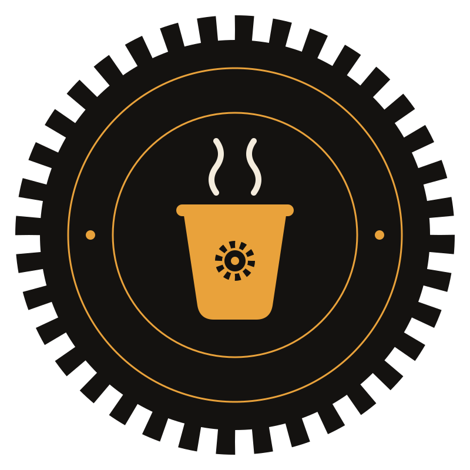
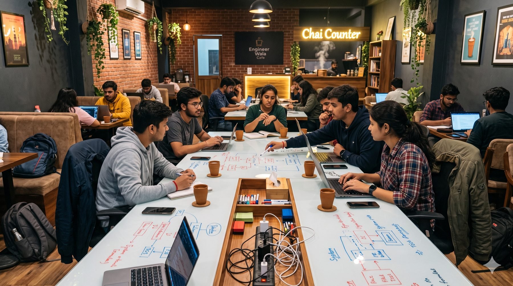
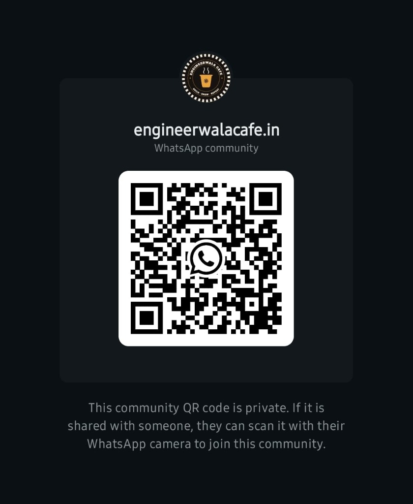

<div align="center">



# Engineer Wala Cafe (Gorakhpur)
### *“Chai ke sath banate hai sab”*

Gorakhpur’s first dedicated cafe & creative workspace for coders, designers, freelancers, and builders.  
Chai peeyo, draw karo, code karo, aur saath milkar build karo.

[](https://maps.google.com)
[](https://chat.whatsapp.com/G0QFuuVkHvK2kMZ3ubMM8E)
[](https://instagram.com/engineerwalacafe.in)
[](#)

---

</div>

## ☕ About the Project

**Engineer Wala Cafe** is designed to solve a simple problem: coders and creators in tier-2 cities like Gorakhpur need a space with fast Wi-Fi, power outlets at every seat, whiteboard brainstorming tables, great chai, and an ambitious community.

This repository powers the official landing page at **[engineerwalacafe.in](https://engineerwalacafe.in)** — built with zero external framework dependencies for maximum speed, accessibility, and smooth aesthetics.

---

## ✨ Features

- **🎨 Modern Warm Off-White Aesthetic**: Designed with an elegant `#FAF7F2` canvas, rich espresso typography, and terracotta accents that feel warm and inviting.
- **🗳️ Live Community Demand Poll**: Real-time interactive poll allowing students and builders to vote on the ideal cafe location (MMMUT, Betiahata, Taramandal, Medical College) and validate pricing models.
- **📱 Instant WhatsApp QR Integration**: Embedded high-resolution WhatsApp Community QR code card for 1-tap or 1-scan onboarding directly from mobile or desktop.
- **⚡ Zero Build Step**: Pure HTML5, Vanilla CSS3, and Vanilla JavaScript. Fast load time, 100% SEO-friendly semantic markup, and zero bundling overhead.
- **📐 Fully Responsive**: Fluid layout tailored across desktop monitors, tablets, and mobile screens.

---

## 📸 Preview & Assets

| Logo | Concept Interior | WhatsApp Community QR |
|:---:|:---:|:---:|
|  |  |  |
| *Official Badge* | *Co-working & Chai Space* | *Scan to Join* |

---

## 📂 Project Structure

```bash
ewc-website/
├── assets/
│   ├── engineerwalacafe-badge-transparent.svg  # Official cafe circular badge
│   ├── whatsapp-community-qr.jpg               # WhatsApp community direct QR
│   ├── cafe-interior.jpg                       # Cafe interior concept preview
│   ├── cafe-counter.jpg                        # Cafe brew counter concept
│   ├── usp-whiteboard-table.jpg                # Whiteboard & builder table concept
│   └── favicon.svg                             # Browser tab icon
├── index.html                                  # Complete single-page website (HTML + CSS + JS)
├── README.md                                   # Project documentation
└── .gitignore                                  # Git ignore list (.DS_Store, etc.)
```

---

## 🚀 Quick Start (Local Run)

No `npm install` or complex setup required! You can open and test it immediately:

### Option 1: Direct in Browser
Simply double-click `index.html` or drag it into Chrome / Safari / Edge.

### Option 2: Live Server (Recommended)
Using Python:
```bash
# Python 3
python3 -m http.server 3000
```
Or using Node.js:
```bash
npx serve .
```
Then visit `http://localhost:3000` in your browser.

> [!NOTE]  
> Modern typography (`Alfa Slab One`, `DM Sans`, `Space Mono`) is loaded via Google Fonts CDN, so an active internet connection is recommended during development.

---

## 🔌 Database Integration (Next Step)

The front-end includes an in-memory & `localStorage` abstraction layer (`DEMO_MODE = true`) ready to be plugged into **Firebase Firestore** or **Supabase**:

| Function | Purpose | Database Table / Collection |
|---|---|---|
| `api.getVotes()` | Fetch aggregate poll counts | `votes` / aggregate counts |
| `api.vote(zone)` | Record user vote | `votes(zone, voter_id, timestamp)` |
| `api.getMyVote()` | Check if user already voted | Local check or Auth session |

### Production Checklist:
- [x] Connect real WhatsApp community QR & invite link (`chat.whatsapp.com/G0QFuuVkHvK2kMZ3ubMM8E`)
- [x] Off-white theme with original brand logo
- [x] Location & pricing validation poll
- [ ] Connect Firebase / Supabase for backend vote persistence & IP rate-limiting
- [ ] Map custom domain `engineerwalacafe.in` via Vercel / Cloudflare Pages

---

## 💬 Connect With Us

- **WhatsApp Community**: [Join Gorakhpur Builders](https://chat.whatsapp.com/G0QFuuVkHvK2kMZ3ubMM8E)
- **Instagram**: [@engineerwalacafe.in](https://instagram.com/engineerwalacafe.in)
- **Website**: [engineerwalacafe.in](https://engineerwalacafe.in)

---

<div align="center">
  <sub>Made with ❤️ & ☕ in Gorakhpur</sub>
</div>
